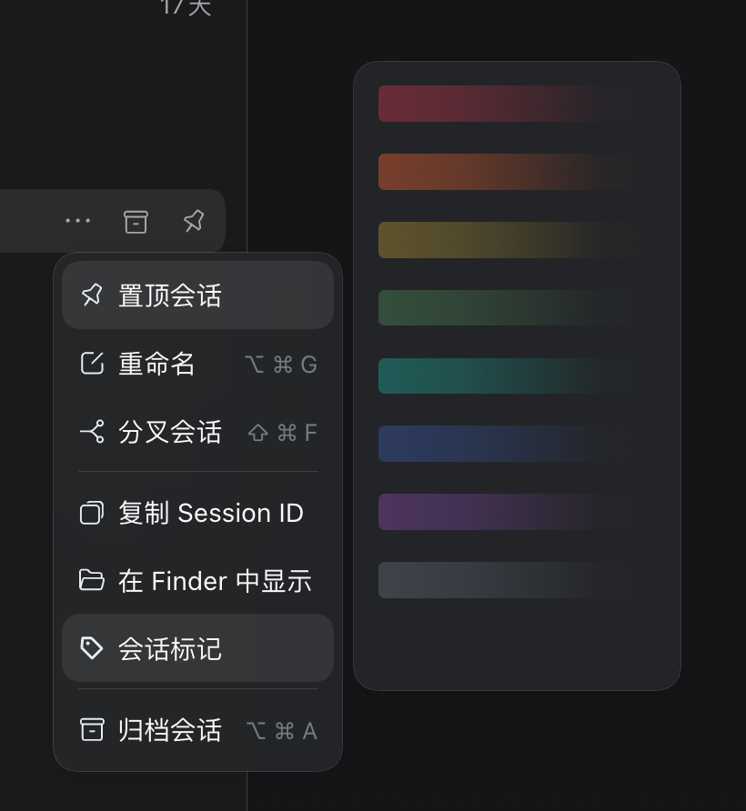
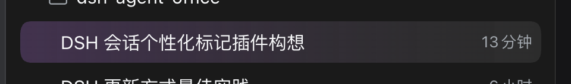

# dsh-session-mark

A plugin for the DeepSeek Harness left session list. It adds a gradient background
to a session row so you can tell sessions apart and avoid opening the wrong one.

English | [中文](README.zh.md)





## Install

```sh
dsh plugin --profile web add github:Makk9609/dsh-session-mark
```

Then restart `dsh web`. You can also install it from the Plugin Manager.

## Usage

Right-click a session → **Session mark** → pick a gradient. The last, blank item
clears the mark.

## Notes

- Eight low-saturation gradients; light and dark themes.
- Only the row background changes. No text, badge, border, or layout change.
- Marks are stored in the browser (`localStorage`), so they survive a reload.
- Only the left session list.

## License

MIT
