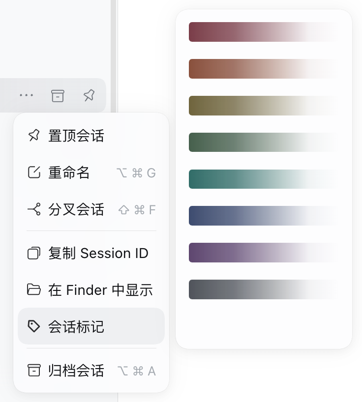

# dsh-session-mark

给 DeepSeek Harness 左侧会话列表加颜色标记的插件。给会话行加渐变底纹或手绘
线条图案，方便区分会话，避免点错。

[English](README.md) | 中文




## 安装

```sh
dsh plugin --profile web add github:Makk9609/dsh-session-mark
```

然后重启 `dsh web`。也可以从 Plugin Manager 安装。

## 使用

右键会话 → **会话标记** → 选一档渐变。最后一项是空白条，点它清除标记。

## 说明

- 八档渐变 + 三个手绘线条图案（星星、猫、狗），支持亮/暗主题。
- 渐变样式给行底纹；图案样式在行首显示小图标。不加文字、徽章、边框，也不改变布局。
- 标记存在浏览器本地（`localStorage`），刷新后保留。
- 只作用于左侧会话列表。

## 许可证

MIT
